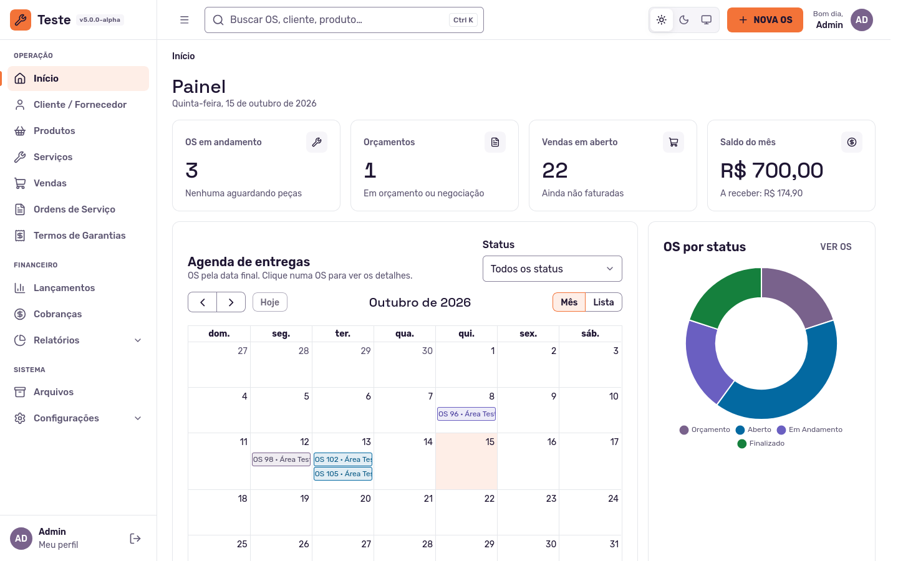
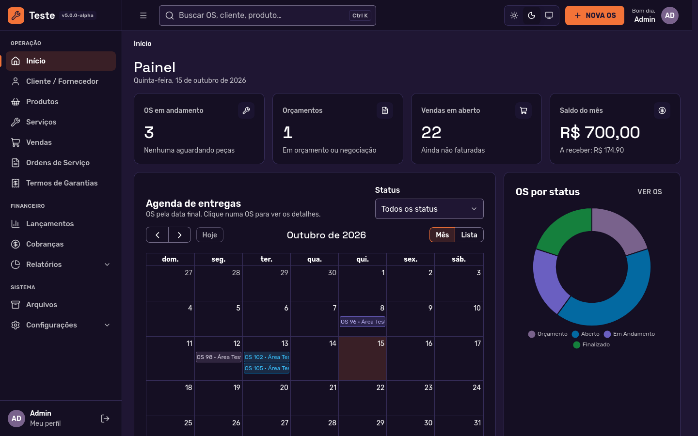

### Contato: contato@mapos.com.br
### [Feedback](https://github.com/RamonSilva20/mapos/discussions) - Vote ou sugira melhorias





### Apoie o Projeto Map-OS - Doações

O **Map-OS** é um projeto open source mantido com muito esforço, dedicação e tempo.
Se ele te ajuda no dia a dia, considere apoiar o desenvolvimento para que o sistema continue evoluindo, recebendo melhorias, correções e novos recursos.

Você pode contribuir de forma simples e segura pelo link abaixo:

**Faça uma doação:** https://donate.mapos.com.br

Toda contribuição, independente do valor, faz a diferença.
Obrigado por apoiar o Map-OS!

### Comunidade no WhatsApp

Participe da comunidade oficial do **Map-OS** no WhatsApp para tirar dúvidas, trocar experiências e acompanhar novidades do projeto:

**Entre na comunidade:**
https://chat.whatsapp.com/GVSg8tPQzXy0grfYpRfQps

### Manutenção do Projeto

O **Map-OS** é um projeto de código aberto **mantido e desenvolvido pela empresa [MountBit](https://mountbit.com.br)**, responsável pela sua evolução contínua, correções e apoio à comunidade.

### Contribuindo

Quer ajudar a melhorar o Map-OS? Leia o **[Guia de Contribuição](CONTRIBUTING.md)** para saber como preparar o ambiente de desenvolvimento, o padrão de código adotado e como abrir um Pull Request.

### SYSGO - Hospedagem Parceira
Acesse seu MAP-OS de qualquer lugar com a SYSGO, a solução de hospedagem pensada para quem busca praticidade, segurança e estabilidade.

Com instalação automatizada, ambiente dedicado ao MAP-OS Oficial, suporte na configuração e utilização, backups e alta disponibilidade, a SYSGO ajuda você a manter seu sistema sempre em funcionamento com confiança.

Solicite seu acesso agora: [Fale com um Especialista!](https://wa.me/sysgo)

<p></p>

### [Instalação](Instalacao_xampp_windows.md)

1. Faça o download do pacote da release (`vX.Y.Z-release.zip`, que já traz o `application/vendor`) ou clone o repositório.
2. Extraia o pacote e copie para seu webserver.
3. Se instalou pelo código-fonte (e não pelo zip da release), rode o comando `composer install --no-dev` a partir da raiz do projeto.
4. Acesse sua URL e inicie a instalação, é bem simples, basta preencher as informações no assistente de instalação **MAPOS** (inclusive a pasta dos anexos, o `STORAGE_PATH`, que deve ficar fora da pasta pública). O instalador cria o banco, aplica as atualizações do banco de dados e grava o `application/.env` só para o dono do arquivo. Se não conseguir aplicar as atualizações, a tela final avisa e o painel mostra o aviso até você usar `Atualizar banco de dados` (Configurações > Sistema) ou rodar `php index.php tools migrate`. Terminada a instalação, o instalador se bloqueia sozinho (`install/instalado.lock` e `application/.env`), mas **apague a pasta `install`** do servidor.
5. Proteja o servidor web (veja [Segurança do servidor](#segurança-do-servidor)): `application/` não pode ser acessível pela URL, e `STORAGE_PATH` deve apontar para uma pasta fora da pasta pública.
6. Configure o email de envio em Configurações > Sistema > E-mail .
7. Configurar cron jobs para envio de e-mail:
    ##### Enviar emails pendentes a cada 2 minutos.
    - */2 * * * * php /var/www/index.php email/process
    ##### Enviar emails com falha a cada 5 minutos.
    - */5 * * * * php /var/www/index.php email/retry

    ##### Obs: O path até o index.php (/var/www/) deve ser configurado conforme o seu ambiente


### Instalação (Docker)

1. Faça o download dos arquivos.
2. Instale o [Docker](https://docs.docker.com/install/) e o [Docker Compose](https://docs.docker.com/compose/install/).
3. Entre na pasta `docker` no seu terminal e rode o comando `docker-compose up --force-recreate`.
4. Acesse a URL `http://localhost:8000/` no navegador e inicie a instalação.
5. Na etapa de configuração use as seguintes configurações:
```
1. Por favor, insira as informações da sua conexão de banco de dados.
Host: mysql
Usuário: mapos
Senha: mapos
Banco de Dados: mapos

2. Por favor, insira as informações para sua conta de administrador.
Configure do jeito que quiser.

3. Por favor, insira a URL.
URL: http://localhost:8000/
```
6. Configure o email de envio em Configurações > Sistema > E-mail .

    ##### Obs: Cuide da pasta `docker/data`, onde é pasta que o mysql do docker salva os arquivos. Se for deletada você perderá seu banco de dados.
    ##### Obs2: O PhpMyAdmin também e instalado e pode ser acessado em `http://localhost:8080/`.

### Instalação Automatizada
Tutorial Instalação: [https://youtu.be/NgXzzBB_2bM?si=FS_R2xq_W0Jnfn33](https://www.youtube.com/watch?v=aZE-LW_YOE4)
#### Windows 10/11
1. Execute o Prompt de Comando ou PowerShell como Administrador;
2. Execute o comando: `PowerShell -command "& { iwr https://raw.githubusercontent.com/RamonSilva20/mapos/master/install.bat -OutFile MapOS_Install.bat }; .\MapOS_Install.bat"`
3. Siga as instrunções na tela.

#### Linux (Ubuntu/Debian)
1. Abra o Terminal ou acesse seu servidor via SSH;
2. Eleve o privilégio aplicando `sudo su` (Recomendado);
3. Execute o comando: `curl -o MapOS_Install.sh -L https://raw.githubusercontent.com/RamonSilva20/mapos/master/install.sh && chmod +x MapOS_Install.sh && ./MapOS_Install.sh`
4. Siga as instruções na tela.

### Segurança do servidor

- O servidor web deve entregar apenas `index.php` e `assets/`. **Não deixe `application/` (onde ficam o `.env`, os logs e, sem `STORAGE_PATH`, os anexos), `updates/` nem arquivos `.sql` acessíveis pela URL.** No Apache isso depende de os `.htaccess` valerem (`AllowOverride`); em Nginx, Caddy e outros, aplique as regras de [docs/servidor-web.md](docs/servidor-web.md). Depois de configurar, teste: `curl -I https://seu-dominio/application/.env` deve responder 403 ou 404, nunca 200.
- Defina `STORAGE_PATH` no `application/.env` com uma pasta **fora** da pasta pública para os anexos de OS e os arquivos enviados ([docs/armazenamento-de-arquivos.md](docs/armazenamento-de-arquivos.md)).
- Atrás de proxy reverso, preencha `APP_PROXY_IPS` ([docs/cookies-e-sessao.md](docs/cookies-e-sessao.md)). Os cabeçalhos de segurança e a CSP estão em [docs/cabecalhos-de-seguranca.md](docs/cabecalhos-de-seguranca.md).
- Autenticação em dois fatores opcional em Meu perfil ([docs/dois-fatores.md](docs/dois-fatores.md)).

### Atualização da 4.x para a v5

A v5 troca a interface, o armazenamento de arquivos e a autenticação, e exige PHP >= 8.5. **Siga o guia [Migração do Map-OS 4.x para a v5](docs/migracao-4x-para-5.md)**: backup, variáveis novas do `.env`, `STORAGE_PATH`, migrations, configuração do servidor web, o que muda para quem personalizou o painel ou usa a API, e como voltar atrás.

### Atualização (v5 em diante)

1. Faça o backup do banco de dados (Configurações > Backup) e dos arquivos: `application/.env`, a pasta do `STORAGE_PATH`, `assets/uploads`, `assets/userImage` e qualquer personalização feita dentro de `assets/img`.
2. Substitua os arquivos pelos da nova versão (o zip da release já traz o `application/vendor`; pelo código-fonte, rode `composer install --no-dev` na raiz).
3. Restaure os backups para seus locais devidos.
4. Logue como administrador, vá em Configurações > Sistema e clique em `Atualizar banco de dados`.
    Obs.: Também é possível atualizar o banco de dados via terminal rodando o comando `php index.php tools migrate` a partir da raiz do projeto.
5. Pronto, sua atualização está concluída.

### Atualização (Docker)

1. Pare o docker de rodar.
2. Faça o backup do banco de dados e dos arquivos, como na atualização acima.
3. Substitua os arquivos pelos da nova versão.
4. Entre na pasta `docker` no seu terminal e rode o comando `docker-compose up --force-recreate`.
5. Logue como administrador, vá em Configurações > Sistema e clique em `Atualizar banco de dados` (ou rode `php index.php tools migrate`).
6. Restaure os backups para seus locais devidos.

### Atualização via sistema

Configurações > Atualizar > **Verificar atualização** baixa a última release com tag do repositório, confere o SHA256 do zip e guarda um backup dos arquivos trocados. Depois clique em `Atualizar banco de dados`. Por padrão só entram releases estáveis (`UPDATER_PRERELEASES=true` inclui pré-releases). O `application/.env`, os uploads, o `application/storage` e a pasta `install/` nunca são alterados. Detalhes em [docs/atualizacao.md](docs/atualizacao.md).

Esse recurso vale a partir da v5. Quem está na 4.x deve usar o guia de migração acima.

### Suporte das versões
| Versão | Branch | Situação | Suporte |
| --- | --- | --- | --- |
| Map-OS em Laravel | — | Em desenvolvimento | Sem data de lançamento |
| 5.x (atual) | `master` | Ativa: novidades e correções | Suporte ativo até a versão em Laravel sair; segurança por mais 12 meses depois |
| 4.x | `4.x` | Só segurança | Até 30/04/2027 |

Quem está na 4.x deve migrar pelo [guia de migração](docs/migracao-4x-para-5.md). O botão "Atualizar Mapos" da 4.55.5 segue o branch `4.x` e não instala a v5.

### Comandos de terminal

Para listar todos os comandos de terminal disponíveis, basta executar o comando `php index.php tools` a partir da raiz do projeto, após feita todo o processo de instalação.

### Frameworks/Bibliotecas
* [bcit-ci/CodeIgniter](https://github.com/bcit-ci/CodeIgniter)
* [mpdf/mpdf](https://github.com/mpdf/mpdf)
* [tailwindlabs/tailwindcss](https://github.com/tailwindlabs/tailwindcss)
* [filp/whoops](https://github.com/filp/whoops)
* [ezyang/htmlpurifier](https://github.com/ezyang/htmlpurifier)

### Requerimentos
* PHP >= 8.5, com as extensões `curl`, `gd`, `mysqli`, `zip`, `mbstring`, `dom`, `xml`, `zlib`, `iconv`, `json`, `openssl` e `fileinfo` (o instalador confere todas)
* MySQL >= 5.7 ou >= 8.0 (ou MariaDB)
* Composer >= 2, só para instalar pelo código-fonte (o zip da release já traz o `application/vendor`)
* Node >= 22, só para quem altera views, CSS ou bibliotecas de JavaScript (veja o [Guia de Contribuição](CONTRIBUTING.md)); instalar o Map-OS nunca exige Node

### Documentação
* [Migração da 4.x para a v5](docs/migracao-4x-para-5.md)
* [Servidor web: o que não pode ser público](docs/servidor-web.md)
* [Atualização pelo painel](docs/atualizacao.md)
* [Armazenamento de arquivos (`STORAGE_PATH`)](docs/armazenamento-de-arquivos.md)
* [Autenticação da API](docs/api-autenticacao.md)
* [Autenticação em dois fatores](docs/dois-fatores.md)
* [Cabeçalhos de segurança e CSP](docs/cabecalhos-de-seguranca.md)
* [Cookies e sessão](docs/cookies-e-sessao.md)
* [Design system (`DESIGN.md`)](DESIGN.md)

### Estrelas
[](https://star-history.dera.page/#RamonSilva20/mapos&Date)

### Contribuidores
[](https://github.com/RamonSilva20/mapos/graphs/contributors)

## Autor
| [<br><sub>Ramon Silva</sub>](https://github.com/RamonSilva20) |
| :---: |
